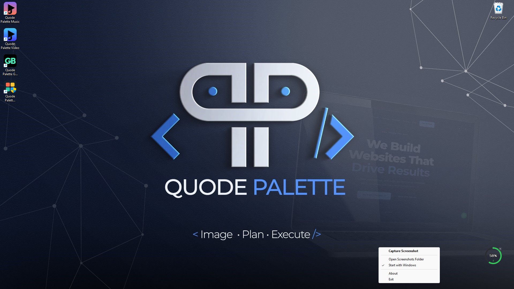
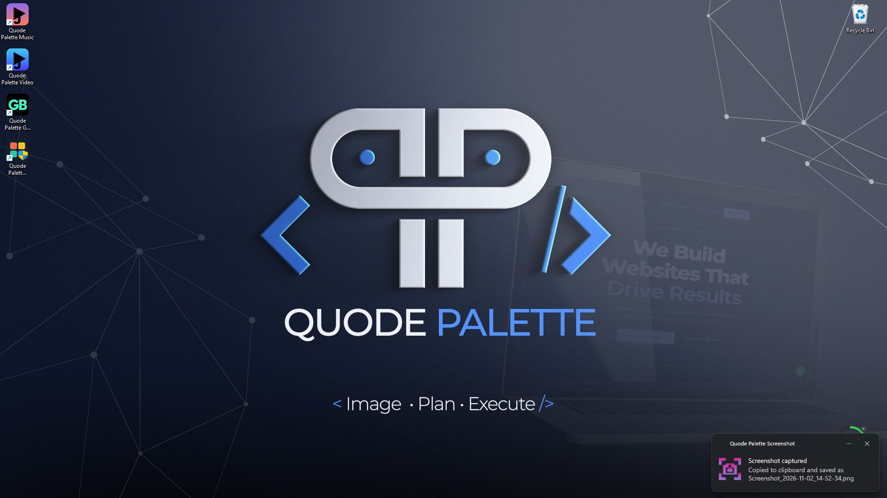

# Quode Palette Screenshot

A small Windows system tray app for taking screenshots without opening a window.

Press Print Screen (single tap) or click the tray icon to capture all monitors. The image is copied to the clipboard and saved as a PNG in your Windows Screenshots folder.

  

  

## Features

- Captures all connected monitors
- Print Screen key takes a screenshot with a single tap
- Brief screen-dim flash on capture, like the Windows screenshot effect
- Clicking the capture notification opens the Screenshots folder
- Single instance: launching again shows an "already running" message
- Fast, lightweight startup
- Copies screenshots to the clipboard
- Saves timestamped PNG files
- Shows a Windows notification after capture
- Opens the Screenshots folder from the tray menu
- Optional startup with Windows
- Runs quietly from the system tray

## Download

Download `Quode Palette Screenshot.exe` from the latest GitHub Release. It is a standalone, single-file executable. Python is not required to run the released app.

If Windows opens its own capture tool on Print Screen, turn off *Settings > Accessibility > Keyboard > Use the Print screen button to open screen capture* so this app can use the key.

Windows may show a SmartScreen warning because the executable is not code-signed. Only run builds you trust.

## Print Screen shortcut

Tap **Print Screen** once, anywhere in Windows, to capture all monitors. The screen dims briefly, the image is copied to the clipboard and saved as a PNG, and a notification appears. No window opens.

If Windows opens its own capture tool instead, turn off *Settings > Accessibility > Keyboard > Use the Print screen button to open screen capture*. If another app has already claimed the key, the tray icon still works.

## Fonts

The font is under the SIL Open Font License.

## License

Released under the [PolyForm Noncommercial License 1.0.0](LICENSE). You are free to use, modify and share it for personal, educational and other noncommercial purposes. For commercial use, please get in touch.
[Email Us](mailto:hello@quodepalette.com)